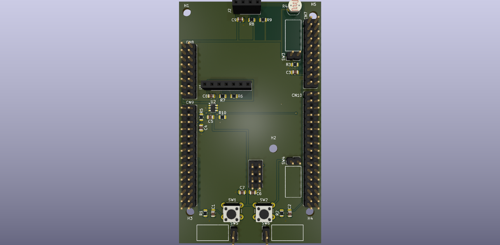
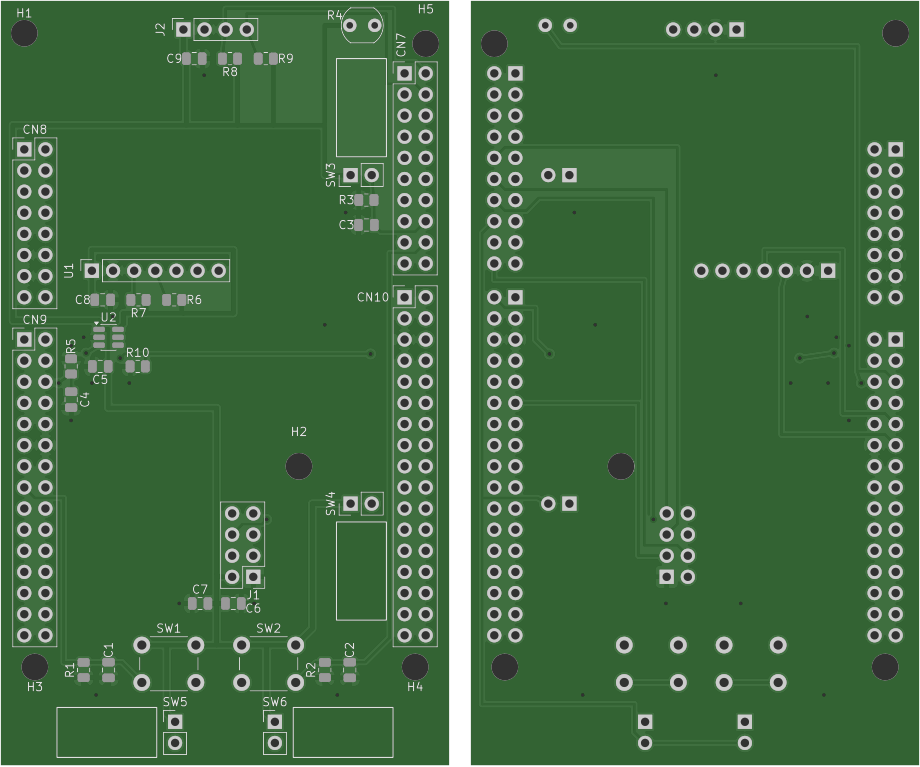

# Shield NUCLEO-U575ZI-Q

Shield fait sous KiCad 10 pour une carte NUCLEO-U575ZI-Q. Il se branche sur les connecteurs Zio de la Nucleo.

Il regroupe :
- un capteur SCD30 (CO₂, humidité, température), qu'on peut couper avec un TPS22918 pour économiser de l'énergie ;
- un petit écran OLED 0,96" en I2C ;
- un module radio 433 MHz (CC1101) en SPI ;
- une photorésistance pour mesurer la lumière ;
- 4 capteurs d'inclinaison pour savoir si on bouge l'appareil ;
- deux boutons.

Schéma : [schema.pdf](schema.pdf)

## Composants

- Capteur CO₂ Sensirion SCD30
- Interrupteur de charge TPS22918DBVR (SOT-23-6)
- Écran OLED Winstar WEA012864D (SSD1306)
- Module radio Ebyte E07-M1101D-SMA (CC1101) + antenne SMA 433 MHz
- Photorésistance GL5528
- 4 capteurs d'inclinaison SW-520D
- 2 boutons Omron B3F-1000
- Résistances et condensateurs CMS 0805
- Barrettes Zio pour la Nucleo, supports femelles 1×4, 1×7 et 2×4 pour les modules

## Brochage

| Fonction | Broches STM32 |
|---|---|
| SCD30 (I2C) | PC0 SCL, PC1 SDA, PF13 marche/arrêt |
| Écran (I2C) | PB8 SCL, PB9 SDA |
| Radio (SPI) | PA5 SCK, PA6 MISO, PA7 MOSI, PF12 CS, PA1 IRQ |
| Lumière, inclinaison | PC3 LUX (analogique), PD14 TILT |
| Boutons | PB6, PD15 |

Le circuit imprimé fait 2 couches et mesure 54 × 92 mm. Le routage est en cours.

